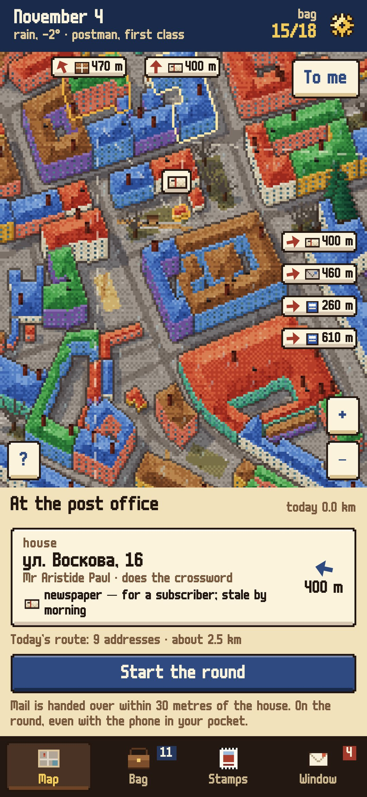
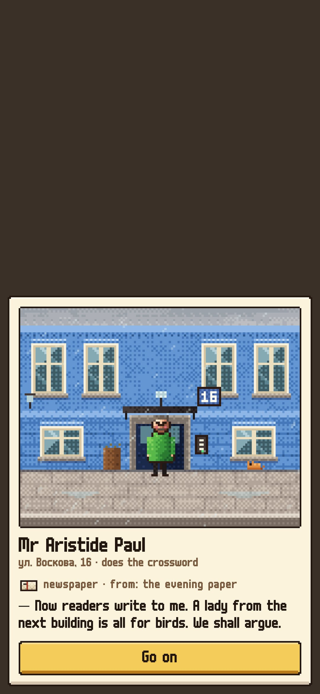
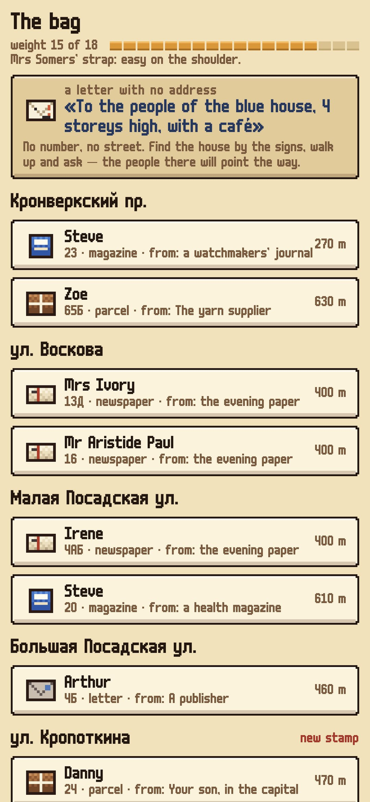
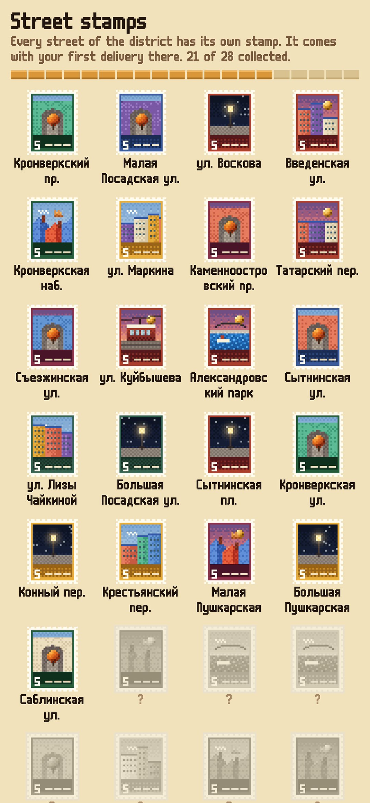

<div align="center">


# Poste Restante

### You are the postman of your own neighbourhood

*The streets and house numbers are real, from the OpenStreetMap map; the people who live in them are made up. Every morning a bag waits for you: letters, postcards, papers, parcels. Mail is handed over only when you stand at the house. The residents write to each other, and you carry their letters back and forth: two old people who met on a skating rink in 1952, a game of chess by post, a grandmother and her granddaughter far away. Free, no ads, no accounts.*

[](https://github.com/bigdevwhale/postround/actions/workflows/android.yml)
[](https://github.com/bigdevwhale/postround/releases/latest)


[](LICENSE)

**English** · [Русский](README.ru.md) · [Changelog](CHANGELOG.md)

   

**[Download APK](https://github.com/bigdevwhale/postround/releases/latest/download/PosteRestante.apk)** · Android 9+ · first version

</div>

---

## How it works

- **The round.** Stand by your front door and the neighbourhood is drawn around you, about a mile across, with the house numbers. The round starts small, some three hundred metres; the more you deliver, the further it grows.
- **The morning bag.** Letters, postcards, magazines, bills, papers for subscribers, parcels. Its size follows how much you've walked lately. No penalties: what you don't deliver today waits for tomorrow.
- **At the door.** Mail is handed over only within thirty metres of the house, by GPS, and never from a tram or a car. You see the door: the facade in the house's colour, the plate with its real number, the resident in the doorway and what they say.
- **The round in a pocket.** Tap "Start the round" and put the phone away: mail is handed over at the doors, and you read what people said later.
- **Telegrams.** They come while you walk and don't wait long.
- **The map.** Tags hang over houses with mail, the houses glow, today's route is dotted, and mail beyond the screen shows as arrows with distances. The "?" button explains every icon.

## Stories between houses

- **Correspondence.** Residents write to each other, and a red thread is drawn on the map between their houses. Sometimes the reply is written at the door and goes straight into the bag; sometimes you're asked to take a parcel to the post office.
- **A year of them.** Sixty stories: the old couple and the rink, chess by post, a Christmas tree stuck on the fourth floor, two yards' snowmen, a starling box, the last school bell, rival mushroom pickers. A new one starts every few days; seasonal ones wait for their time of year.
- **Letters with no address.** "To the people of the yellow five-storey house by the chemist's." No number, no street: find it by the signs, walk up and ask, and they'll point the way. They're written by the old postwoman who carried this round for thirty-eight years.
- **The poste restante window.** When a correspondence ends, the residents write to the postman.
- **Street stamps.** Every street has its own stamp, drawn in code: water and a bridge, a tram, a little park, roofs with a cat, a lamp, an archway. It comes with your first delivery on that street.
- **Grades.** From postman third class to the postman everyone knows.

## Steps

The morning bag follows how much you really walk. Steps come from the phone's own step counter (it counts even with the game closed) or from Health Connect: Mi Fitness, Samsung Health, Google Fit, watches and bands. Pick the source in Settings.

## Privacy

Your location and steps stay on the phone. The network is used only for the district map (OpenFreeMap tiles from OpenStreetMap data, once, when you pick your home) and the weather (MET Norway, rounded coordinates). No accounts, ads or analytics. See [PRIVACY.md](PRIVACY.md).

## Build

```
./gradlew assembleDebug                 # app.postround.dev
./gradlew assembleDebug -Pdemo          # app.postround.demo: Petrogradskaya, St Petersburg, ten days already played
./gradlew testDebugUnitTest -Prender --tests '*RenderArtScreens*' && python tools/shots.py
PYTHONIOENCODING=utf-8 python tools/check_content.py   # checks the texts
```

In the demo a long press on the map moves the postman. All texts are in `app/src/main/assets/content`; the format is in [docs/CONTENT.md](docs/CONTENT.md).

Map data © OpenStreetMap contributors (ODbL). Tiles by OpenFreeMap. Weather by MET Norway. m6x11 font by Daniel Linssen. MIT licence.
