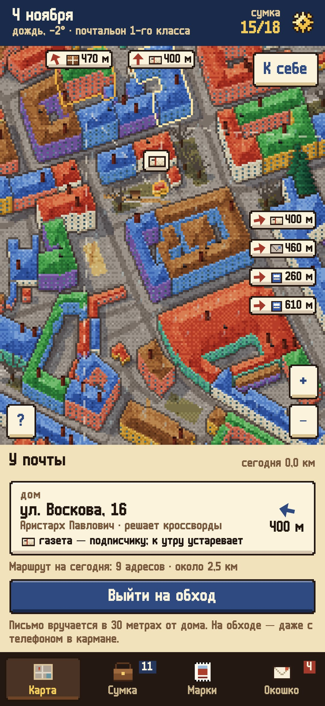
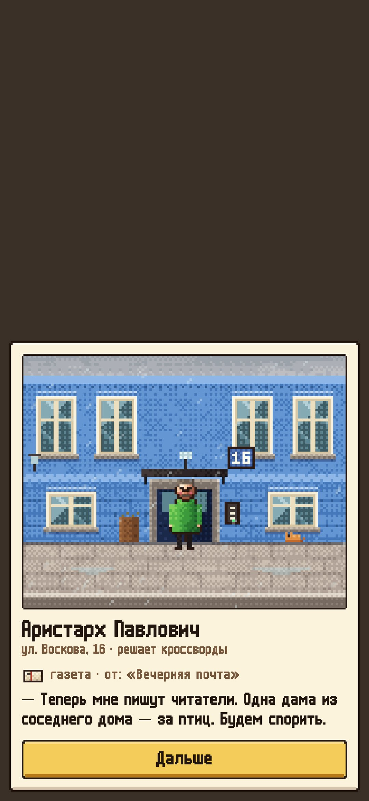
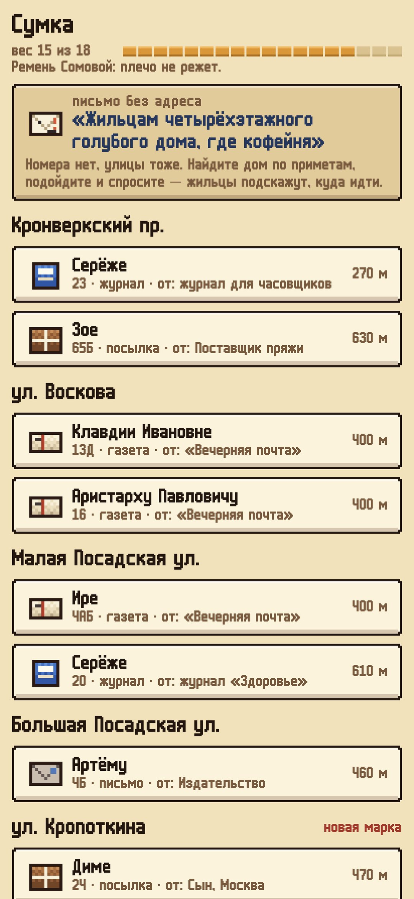
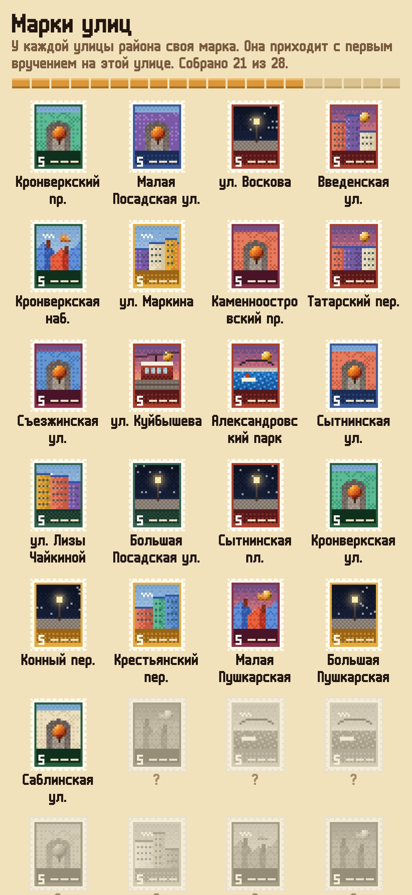

<div align="center">


# До востребования

### Вы — почтальон своего района

*Улицы и номера домов настоящие, с карты OpenStreetMap, а жильцы выдуманные. Каждое утро вас ждёт сумка с письмами, открытками, газетами и посылками. Письмо вручается, только когда вы стоите у дома. Жильцы переписываются между собой, и вы носите их письма туда и обратно: двое стариков, которые познакомились на катке в пятьдесят втором, шахматная партия по почте, бабушка и внучка за три тысячи километров. Бесплатно, без рекламы и аккаунтов.*

[](https://github.com/bigdevwhale/postround/actions/workflows/android.yml)
[](https://github.com/bigdevwhale/postround/releases/latest)


[](LICENSE)

[English](README.md) · **Русский** · [Изменения](CHANGELOG.md)

   

**[Скачать APK](https://github.com/bigdevwhale/postround/releases/latest/download/PosteRestante.apk)** · Android 9+ · первая версия

</div>

---

## Как это устроено

- **Участок.** Встаньте у своего подъезда, и вокруг нарисуется район примерно полтора на полтора километра, с номерами домов. Сначала участок небольшой, метров триста. Чем больше вы разнесёте, тем дальше он раздвигается.
- **Утренняя сумка.** В ней письма, открытки, журналы, счета, газеты для подписчиков и посылки. Её размер зависит от того, сколько вы ходили последние дни. Никаких штрафов: что не успели сегодня, донесёте завтра.
- **Вручение у двери.** Письмо можно отдать, только если вы в тридцати метрах от дома: это проверяет GPS. Из трамвая или машины не получится. Вы видите сцену у подъезда: фасад в цвет дома, табличку с настоящим номером, жильца в дверях и его ответ.
- **Обход в кармане.** Нажмите «Выйти на обход» и уберите телефон: у дверей почта вручится сама, а что сказали жильцы, прочтёте потом.
- **Телеграммы.** Приходят прямо на прогулке и ждут недолго, к сроку надо успеть.
- **Карта.** Над домами с почтой висят бирки, сами дома светятся контуром, маршрут на день отмечен точками, а письма за краем экрана показаны стрелками с расстоянием. Что значит каждый значок, объясняет кнопка «?».

## Истории между домами

- **Переписки.** Жильцы пишут друг другу, и между их домами на карте натягивается красная нить. Иногда ответ пишут прямо при вас, и он сразу ложится в сумку. Иногда жилец просит отнести посылку на почту.
- **На год вперёд.** Шестьдесят историй: старики и каток, шахматы по почте, ёлка, застрявшая на четвёртом этаже, снеговики двух дворов, скворечник, последний звонок, грибники-соперники. Новая история начинается раз в несколько дней, сезонные ждут своего времени года.
- **Письма без адреса.** «Жильцам жёлтого пятиэтажного дома у аптеки». Номера нет, улицы тоже. Найдите дом по приметам, подойдите и спросите. Жильцы подскажут, в какую сторону идти. Пишет их старая почтальонша, которая носила этот участок тридцать восемь лет.
- **Окошко «До востребования».** Когда переписка заканчивается, жильцы пишут почтальону: благодарят, что-нибудь передают.
- **Марки улиц.** У каждой улицы района своя марка, нарисованная в коде: вода и мост, трамвай, сквер, крыши с котом, фонарь, арка во двор. Она приходит с первым вручением на этой улице.
- **Классы почтальона.** От третьего класса до «почтальона, которого знают в лицо».

## Шаги

Утренняя сумка собирается по тому, сколько вы на самом деле ходите. Шаги можно брать из встроенного шагомера телефона (он считает, даже когда игра закрыта) или из Health Connect: Mi Fitness, Samsung Health, Google Fit, часы и браслеты. Источник выбирается в настройках.

## Приватность

Координаты и шаги остаются в телефоне. Сеть нужна только для карты района (тайлы OpenFreeMap по данным OpenStreetMap, один раз при выборе дома) и для погоды (MET Norway, координаты округлены). Без аккаунтов, рекламы и аналитики. Подробнее — в [PRIVACY.md](PRIVACY.md).

## Сборка

```
./gradlew assembleDebug                 # app.postround.dev
./gradlew assembleDebug -Pdemo          # app.postround.demo: Петроградская сторона, десять дней уже позади
./gradlew testDebugUnitTest -Prender --tests '*RenderArtScreens*' && python tools/shots.py
PYTHONIOENCODING=utf-8 python tools/check_content.py   # проверка текстов
```

В демо-сборке почтальона переносит долгое нажатие на карту. Все тексты лежат в `app/src/main/assets/content`, формат описан в [docs/CONTENT.md](docs/CONTENT.md).

Данные карты © участники OpenStreetMap (ODbL). Тайлы — OpenFreeMap. Погода — MET Norway. Шрифт m6x11 — Daniel Linssen. Лицензия MIT.
